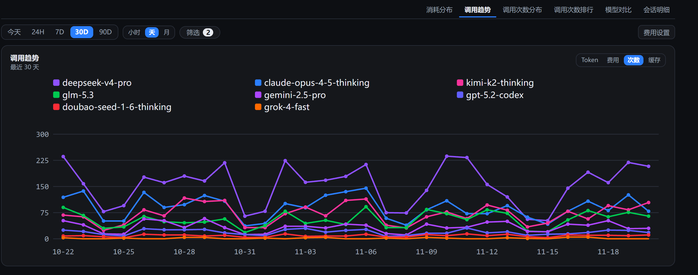
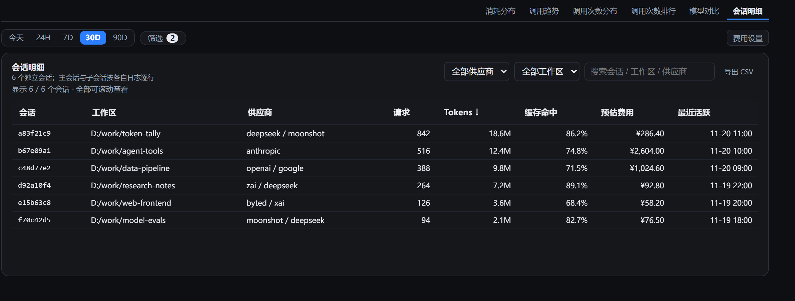
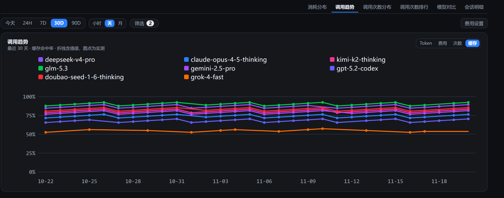

<div align="center">

# 📊 Token 台账 — dsh-token-tally

**DeepSeek Harness 的 Token 用量与费用看板：六页签消耗视图 · 缓存命中趋势 · 日/周/累计活动 · 多维排行 · 会话明细**

像 newapi 数据看板那样看「哪个模型、什么时候、花了多少、占多少」，外加一张多模型同屏对比表用于复盘与成本核算。全部统计在**本机**完成，不上传任何会话内容。

[](https://www.npmjs.com/package/dsh-token-tally)
[](https://www.npmjs.com/package/dsh-token-tally)
[](https://github.com/BioAIEvolu/dsh-token-tally/stargazers)
[](https://github.com/BioAIEvolu/dsh-token-tally/network/members)
[](https://awesome-dsh-plugin.com)
[](LICENSE)
[](https://github.com/deepseek-ai/deepseek-harness)

如果这个项目帮到了你，请考虑 ⭐ **Star** 支持一下，让更多人发现它！

</div>

---

## 📸 功能预览

> 以下截图由插件的**真实渲染代码**生成，使用演示数据（非任何真实会话数据）。


| 调用趋势（每模型折线） | 调用次数分布（环形图） |
| --- | --- |
|  |  |
| **调用次数排行** | **模型对比表** |
|  |  |

**会话明细：工作区 + 精确用量**



**缓存命中率时间序列**（折线贯穿全窗，缺失遥测按相邻实测插值；圆点只标真实测量值）：



---

## ✨ 你能用它做什么

### 六页签消耗视图（newapi 式布局）

| 页签 | 图表 | 口径切换 |
| --- | --- | --- |
| **消耗分布** | 堆叠柱：X=时间桶（粒度自适应），段=模型 | 费用 / Token；**绝对值 ↔ 100% 占比**一键切换 |
| **调用趋势** | 每模型折线 | 次数 / Token / 费用 |
| **调用次数分布** | 环形图（模型） | 次数 / Token / 费用 |
| **调用次数排行** | 条形排行：模型 / 供应商 / 项目三维度 | 次数 / Token / 费用 |
| **模型对比** | 单页对比表：每模型一行，多列指标并排 | 列头排序；点击行联动全看板筛选 |
| **会话明细** | 每份会话日志一行：工作区、请求、Tokens、缓存命中、费用 | 供应商/工作区筛选、搜索、全列排序；全量滚动与 CSV 导出 |

- 堆叠柱支持 **绝对值 / 100% 占比** 切换（newapi 与 cc-switch 都没有的交互）；
- 摘要类页签只随时间范围和筛选变化，不随图表粒度变化；
- 时间桶对齐小时边界（`created_at - created_at % 3600` 语义）。

### 用量活动、排行与会话明细

- **活跃摘要**：最高单日、截至今天的连续活跃与历史最佳、近 7 日变化，内嵌在消耗分布的活动卡标题区，不再重复开一排 KPI；
- **活动三视图**：消耗分布内的 53 周日热力图、周聚合柱、累计曲线；动画按整组执行，不与环形图扫描争帧；
- **排行三维度**：模型 / 供应商 / 项目复用同一排行图，供应商按全部模型合并，项目按会话工作区聚合；
- **会话明细**：主会话与子会话按各自日志逐行展示，不虚构父子树；全部会话在独立滚动区查看，支持供应商/工作区筛选、文本搜索和点击列头排序，支持 CSV 导出；
- **缓存命中率趋势**：按模型分色，折线贯穿整个时间窗；中间缺桶按相邻实测插值，首尾沿用最近实测延伸，圆点仅标真实测量值；

### 模型对比表（复盘核心）

每行 = 一个模型（provider + model 归一组），受当前时间范围与筛选器影响：

| 列 | 说明 |
| --- | --- |
| 模型（+供应商） | 归一后的模型名；同模型多 provider 分行显示 |
| 调用次数 | 含成功率（悬停显示失败次数） |
| 输入 / 输出 / 缓存 Tokens | 输入含缓存读+写展开（悬停明细） |
| 预估费用 + 占比 | 行内迷你条形显示占比；¥/$ 跟随全局切换 |
| 实际单价 | 预估费用 ÷ 总 Token，折算「每百万 Token」 |
| 输出速度 | outputTokens ÷ 生成时长（tok/s，中位数与均值并列） |
| 响应时长 | P50 / P95（毫秒），对数分桶直方图聚合，跨窗口可比较 |
| 缓存命中率 | cacheRead / cacheObserved；覆盖率 <100% 标注提示 |

- 点列头排序（费用/速度/命中率/单价）；
- 点击行 = 全看板按该模型筛选，再点解除；
- 表格支持导出 CSV（含公式注入防护）。

### 用量活动 + KPI + 筛选器

- **活动三视图**：GitHub 式日热力图（7 行 × 53 列）、周聚合柱与累计曲线，随供应商/模型筛选联动；
- **KPI 行**：预估费用、计费/输入/输出/缓存 Tokens、缓存命中率、用量请求、会话数（含遥测覆盖率）；
- **筛选器**：今天 / 24H / 7D / 30D / 90D / 自定义起止；供应商/模型多选（按厂商分组级联下拉）；筛选持久化在 localStorage。

图表全部为手写 SVG，跟随 DSH 明暗主题 CSS 变量，**零第三方运行时依赖**。

## 📦 安装

**方式一 · 插件市场（推荐）**：打开 DSH 设置 → 插件 → 发现，搜索 `token-tally` 安装。

**方式二 · CLI**：

```bash
dsh plugin --profile web add dsh-token-tally
dsh web   # 重启生效
```

**方式三 · 从源码**：`git clone` 本仓库后 `dsh plugin --profile web add "link:<仓库路径>"`。

安装后重启 `dsh web`，打开 **设置 → Token 台账**。完整步骤、卸载与故障排查见 [INSTALL.md](./INSTALL.md)。

## 🧮 口径说明（重要）

- **费用为估算**：token × 本地价目表（`pricing/models.csv` 或设置页手动覆盖），不含折扣/赠送额度/税费，**不代表账单**；
- **未配置价格的模型显示「未配置价格」，绝不显示 ¥0**；
- 默认纳入主会话与子代理会话，按各自日志折叠并跳过继承的父历史前缀，避免双计；会话明细页逐行展示，**不合并为会话树**；
- compaction（内部压缩调用）的 token 计入统计（多数参考实现会漏计）；
- 首次启动全量回填历史会话（本机 101 会话实测 ≈4 秒），之后走增量 + 磁盘缓存。

## 🔒 隐私与安全

- 所有聚合在**本机**完成，不上传任何会话内容；
- `/token-tally-api/*` 只读路由默认仅接受 loopback 来源（非 loopback 403）；
- 请勿将带本插件的 WebServer 暴露到公网。

## 🙏 致谢与出处（许可证边界）

本项目代码**全部原创**，以 MIT 发布。

- **[new-api](https://github.com/QuantumNous/new-api)（AGPL-3.0）**：仅概念级参考其数据看板的数据模型与交互布局，零代码复制、零源码引入；
- **dsh-usage-dashboard（Apache-2.0）**：rollup/磁盘缓存思路参考；
- **model-usage-plugin（MIT）**：计费规则参考；
- **cc-switch（MIT）**：信息架构参考；
- **[dsh-profile-stats](https://github.com/Lovenndme/dsh-profile-stats)（MIT）**：活跃卡片、日/周/累计活动、供应商与项目拆分的显示参考；
- **[dsh-token-total](https://github.com/GaoHu1997/dsh-token-total)（MIT）**：会话用量、缓存命中趋势、输入/输出/缓存汇总卡的显示参考；
- 本次整合未复制上述项目的源码文件；版权与参考边界见 [THIRD_PARTY_NOTICES.md](./THIRD_PARTY_NOTICES.md)；

## 🛠 开发

```bash
npm install
npm run build   # src/ → lib/
npm test        # 全量回归（离线运行）
```

架构设计、数据流与已知约束见 [docs/DESIGN.md](./docs/DESIGN.md)；在 DSH 创作模式会话里继续开发的提示词见 [HANDOFF.md](./HANDOFF.md)。

## 📄 License

[MIT](./LICENSE)
